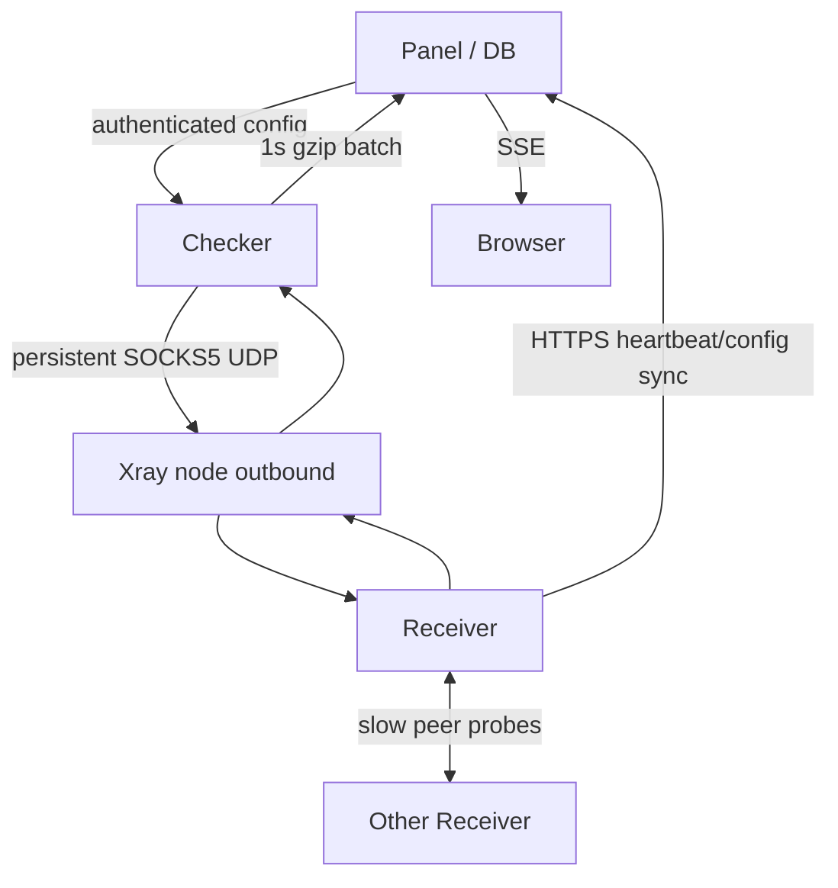

# Архитектура

## Процессы

Checker и Panel остаются разными процессами. Checker владеет Xray runtime и hot path, Panel — source of truth для operational settings, Receiver registration, history, alerts и UI. Checker не открывает Panel DB напрямую.

Прямой `Checker → Receiver` probe идёт параллельно только как control/health сигнал. Он не входит в RTT VLESS path и не вычитается из proxied RTT.

## 10 Hz data plane

Для каждого активного `node × receiver` Scheduler держит один `nextDue`. Один общий ticker равномерно фазирует paths по FNV hash; bounded worker queue не создаёт catch-up storm. На probe нет отдельной goroutine и timer.

На каждый Xray node Runtime держит максимум одну persistent SOCKS5 `UDP ASSOCIATE`; через неё мультиплексируются все Receiver targets. При обрыве association пересоздаётся с exponential backoff. Удаление node закрывает association и очищает pending probes этого node.

Pending probes лежат в sharded bounded map + expiration wheel. В сеть отправляется probe только после успешного резервирования pending slot. Локальная невозможность отправить/обработать измерение становится gap/`INVALID`, а не network `LOSS`.

## Receiver

Receiver — небольшой Go UDP service. Один read loop проверяет размер, magic/version, HMAC, timestamp, replay и rate limit, затем формирует ответ не больше request. Он не классифицирует VLESS как хороший/плохой.

При `2+ Receiver` Panel раздаёт peer targets, и каждый Receiver медленно проверяет остальные. Heartbeat приносит peer loss/RTT обратно в Panel/Checker. Это позволяет отличить проблему точки наблюдения от проблемы конкретного VPN path.

Receiver разрешено ставить рядом с VLESS. `local_node_sid` автоматически добавляется в exclusions только для `VLESS → Receiver`; peer monitoring не отключается.

## Aggregation и confidence

Path window хранит bounded final outcomes. RTT — monotonic elapsed time. Основные показатели: median, p90/p95, robust jitter (median absolute successive RTT difference), loss только среди фактически отправленных probes, coverage по ожидаемому time grid.

Node aggregation использует только Receiver с достаточным health/confidence. RTT/jitter агрегируются weighted median, где вес зависит от confidence и coverage, а не от маленького RTT. Regional loss disagreement сохраняется отдельно.

Финальное правило:

- все известные healthy paths нормальны → `ONLINE`;
- есть подтверждённый плохой healthy path → `DEGRADED`;
- все известные healthy paths offline → `OFFLINE`;
- нет достаточных healthy observations → `UNKNOWN`.

Anti-flap применяет streaks к переходам, но `UNKNOWN/DISABLED/UNSUPPORTED` не маскируются ложным outage.

## Overload control

Self-monitoring смотрит на scheduler lag, queue occupancy и omissions. `HIGH_LOAD` — краткий/неподтверждённый сигнал; adaptive sampling включается только в `OVERLOADED`.

Отдельные переключатели позволяют автоматике менять probe rate, число active Receiver и playback delay. Приоритет проблемных nodes действует только во время overload. Missing local opportunity не создаёт sample.

## Transport и storage

Checker собирает реальные sub-second outcomes в one-second compact blocks и отправляет один gzip HTTP batch примерно раз в секунду. Panel сразу публикует batch в SSE, а DB пишет батчами примерно раз в 10 секунд.

Raw result format — `uint16/slot`, DB row обычно одна минута на конкретный interval grid. Разные Hz внутри одной минуты имеют разные `(start_ms, interval_us)` keys. Retention raw по умолчанию 24 часа; aggregates — 30 дней. SQLite и PostgreSQL используют одну store abstraction.

## TCP compatibility

Legacy TCP checker, `/api`, Prometheus TCP metrics, subscriptions, stable IDs, balance groups и statuspage history не переопределяются UDP state. Existing `online` остаётся TCP-состоянием. UDP можно выключить без остановки TCP.
